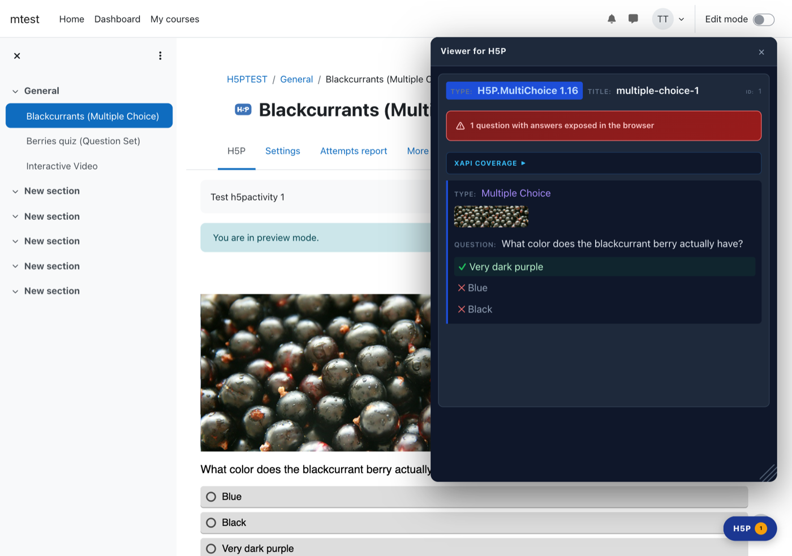

# Viewer for H5P (Moodle)

See every question and answer in the H5P on a Moodle page: its type, and which answers are right. For teachers and course builders.

Free and open source (GPL v3). The Moodle sister of [Viewer for H5P for WordPress](https://aikellogg.com/#/viewer-for-h5p).

## What it shows

Open any Moodle page with H5P (an H5P activity, or H5P embedded in a page, label or forum post) and an **H5P** button appears in the bottom-right corner, with a badge counting the items. Click it for a panel with, for each item:

* its content type and title
* every question, with every answer, the correct ones marked
* the questions inside Question Sets, Interactive Videos (with their times), Course Presentations, Columns and Branching Scenarios
* its xAPI coverage

## Who sees it

The capability **local/viewerforh5p:view**: editing teachers and managers by default, never students. Change it in **Site administration → Users → Permissions → Define roles**. Students don't even get the script.

## Why it matters

Moodle shows H5P inside a frame (`/h5p/embed.php`), and that frame gets each item's full settings, **answers included**, in `H5PIntegration` (`public/h5p/classes/player.php` in Moodle 5.x). The viewer only reads what's already there. Every learner's browser has it too, where anyone can read it with the developer tools: H5P as it ships can't be trusted for real testing.

## Install

1. Copy this folder to `local/viewerforh5p` in your Moodle (`public/local/viewerforh5p` in Moodle 5.1+), or install the zip in **Site administration → Plugins → Install plugins**.
2. Visit **Site administration → Notifications** to finish.
3. Open an H5P activity as a teacher: the **H5P** button is in the bottom-right corner.

Requires Moodle 4.1 or later. Tested on Moodle 4.5.16 (LTS) with PHP 8.2 and MySQL 8.4.

## Support

Report bugs and ask for features in the [issue tracker](https://github.com/pfkellogg/moodle-viewer-for-h5p/issues).

## Licence

GNU GPL v3 or later (see `LICENSE`).

## Privacy

It stores nothing and sends nothing anywhere: it reads the H5P already on the page.

---

H5P is a registered trademark of H5P Group. This plugin is independent: it is not made or endorsed by H5P Group. Made by Patrick Kellogg.
